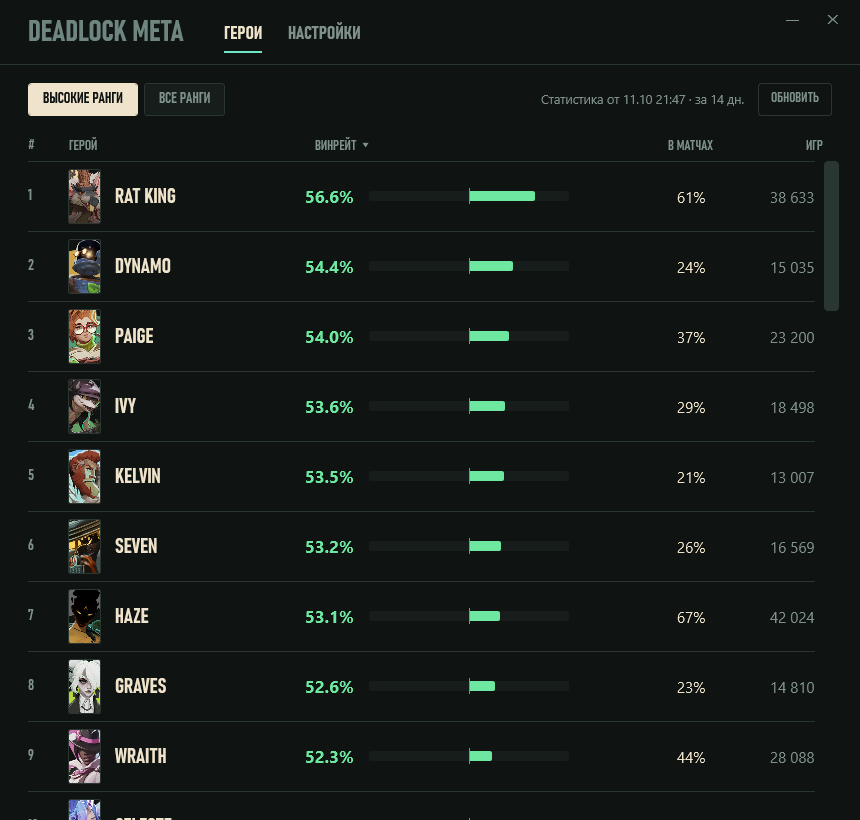
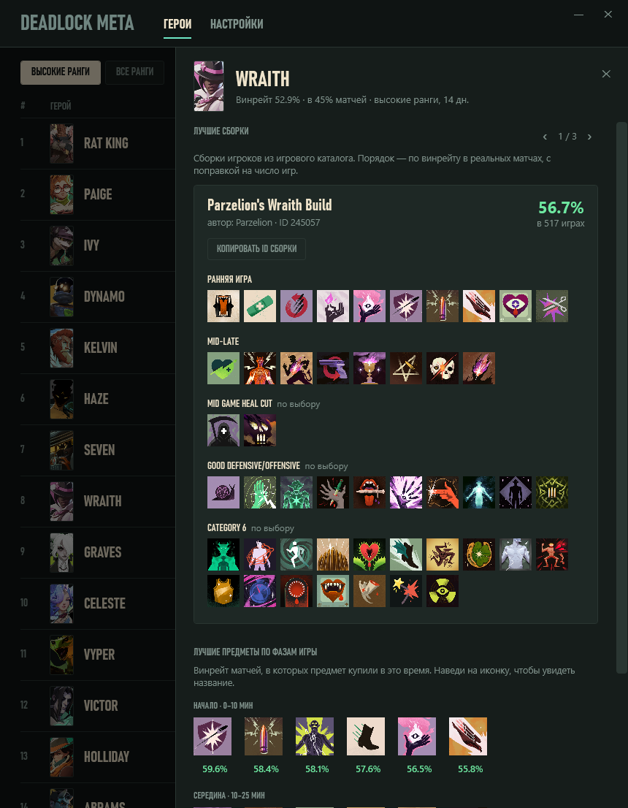
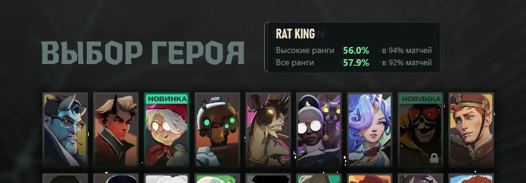

# Deadlock Meta

Актуальный винрейт героев Deadlock — в отдельном окне и прямо в игре, на экране выбора героя.







## Что умеет

- **Таблица героев**: винрейт, доля матчей с героем и число игр. Отдельно для высоких рангов и для всех, с сортировкой по любому столбцу.
- **Сборки и предметы**: нажми на героя в таблице — выедет панель с тремя лучшими сборками игроков (по винрейту в реальных матчах, с копированием ID) и лучшими предметами для начала, середины и конца игры.
- **Автообновление**: когда выходит новая версия, в окне появляется кнопка «Обновить».
- **Оверлей**: на экране выбора героя наводишь курсор на карточку — рядом с заголовком появляется плашка с винрейтом. Зелёный — 50% и выше, красный — ниже.
- **Настройки**: период статистики (7, 14 или 30 дней) и порог «высоких рангов» (от Emissary до Eternus).

Статистика берётся из открытого API сообщества [deadlock-api.com](https://deadlock-api.com) и обновляется автоматически.

## Установка

1. Скачай архив со страницы [Releases](../../releases) и распакуй куда угодно.
2. Запусти `DeadlockMeta.exe`. Если Windows покажет окно «Система Windows защитила ваш компьютер» — нажми «Подробнее» → «Выполнить в любом случае» (программа не подписана).
3. В Deadlock включи режим «Окно без рамки» (Настройки → Видео).
4. Открой экран выбора героя и наведи курсор на героя.

Устанавливать .NET не нужно — всё внутри exe. Нужна Windows 10 или 11 (64-бит).

Подробная инструкция лежит в архиве (`ИНСТРУКЦИЯ.txt`) и в [docs/INSTRUCTION_RU.txt](docs/INSTRUCTION_RU.txt).

## Как это работает и безопасно ли

Программа не трогает игру: не читает её память, не внедряется в процесс и не меняет файлы. Она делает снимки экрана, как программа для записи видео, сравнивает карточки героев с их портретами и рисует своё прозрачное окно поверх. Гарантий от Valve нет, но это тот же класс программ, что и обычные оверлеи.

Что известно на сейчас:

- проверено на 1920×1080; на других разрешениях сетка героев ищется автоматически, но это ещё не тестировалось;
- работает только в режиме «Окно без рамки»;
- если Valve перерисует экран выбора героя, распознавание придётся обновить.

## Если не работает

Пришли файл `data\log.txt` (Настройки → «Открыть папку с логом»), скриншот экрана выбора героя и разрешение монитора — через [Issues](../../issues).

## Сборка из исходников

Нужен [.NET 10 SDK](https://dotnet.microsoft.com/download).

```powershell
.\publish.ps1
```

Скрипт собирает `app\DeadlockMeta.exe` и архив `release\DeadlockMeta-<версия>.zip`.

| Папка | Что внутри |
|---|---|
| `Core\` | распознавание карточек, захват экрана, загрузка статистики, слежение за игрой |
| `MainWindow.xaml`, `OverlayWindow.cs` | главное окно и плашка поверх игры |
| `tests\e2e.ps1` | проверка оверлея на сохранённом скриншоте, без игры |
| `tools\make-icon.ps1` | генерация иконки |

Проект не связан с Valve. Deadlock — товарный знак Valve Corporation.
